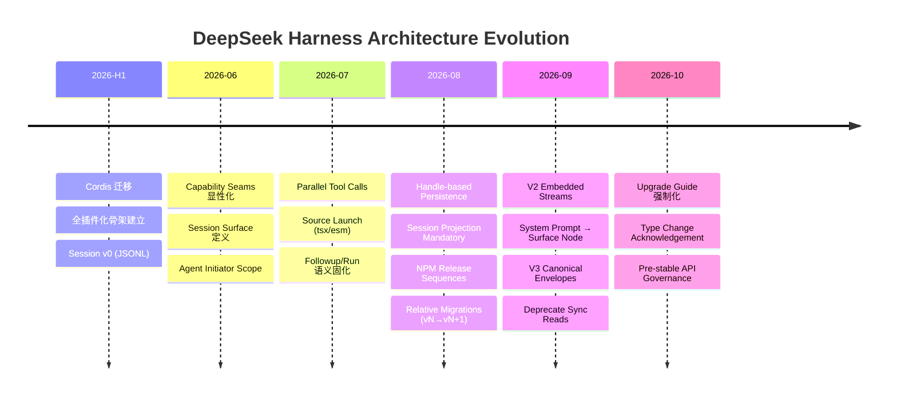

# Evolution Timeline — 架构演进关键节点

> **来源**：`.agents/notes/implemented/architecture/`、`docs/upgrade-guide/`、Git history、`docs/session-format-status.md`、`docs/cookbook/reviewing-persistence-type-changes.md`。
> **范围**：关键版本节点、Breaking Change、架构决策演进、API 表面变更。

---

## 版本里程碑概览

| 时期 | 核心主题 | 关键产出 |
|------|----------|----------|
| **2026-H1** | Cordis 迁移、插件化骨架、Session v0 | `vendor/cordis`、核心包拆分、JSONL v0 |
| **2026-Q3** | Session 格式版本化、相邻迁移、Capability Seams 显性化 | `SESSION_FORMAT_VERSION`、迁移包、seam 文档生成 |
| **2026-Q4** | Agent/Loop 分离、Initiator Scope、双 SDK 投影、预稳定 API 治理 | `dsh-agent`/`dsh-agent-loop`、Python SDK、upgrade guide 机制 |

---

## 关键节点详表（按时间倒序）

### 2026-10：预稳定 API 治理与升级指南强制化
- **触发**：对外可感知破坏性变更（CLI、profiles、cordis.yml keys、持久化用户数据、SDK/wire APIs、published entry points）必须即时记录升级指南。
- **机制**：`dsh-create-upgrade-guide` skill 强制 `docs/upgrade-guide/v<version>/<item>/guide.md`。
- **类型变更确认单**：`docs/cookbook/reviewing-persistence-type-changes.md` — 每次持久化类型变更需在 PR 中确认。

### 2026-09-09：弃用同步 Session 事件读取
- **Agent Note**：`2026-09-09-deprecate-synchronous-session-event-reads.md`
- **变更**：`Session.eventAt`、`snapshotEvents`、`ownEvents` 标记 `@deprecated`；新代码禁止调用。
- **替代**：`SessionHandle.read()` + `SessionHandle.append()` + `flush()`。
- **理由**：Source plane vs artifact plane 分离；同步读阻碍 handle-based 持久化模型。

### 2026-09-06：V3 Canonical Session Envelopes
- **Agent Note**：`2026-09-06-v3-canonical-session-envelopes.md`
- **变更**：`request/header` 强制规范化——`system` 字段禁用、`tools: []`/`adapterDefaults: {}` 必须省略。
- **拒绝**：Legacy v0 logs 中的 `request/header-delta` 或 `fallback` reason。
- **迁移**：`session-migration-v2-v3` 包处理历史转换。

### 2026-09-02：System Prompt as Surface Node
- **Agent Note**：`2026-09-02-system-prompt-as-surface-node.md`
- **变更**：System prompt 从 `EpochHeader` 移出，成为 `system/message` surface node 0。
- **影响**：
  - `request/header` 不再包含 system 文本。
  - Prompt 变更 = `system/message` 的 `replace`/`append`，留下 header 不变。
  - Incapable route / new series 归一化到首节点，空渲染清空所有活跃节点。

### 2026-09-01：V2 Embedded Assistant Streams
- **Agent Note**：`2026-09-01-v2-embedded-assistant-streams.md`
- **变更**：`assistant/message` 内嵌 `stream: AssistantStreamRecord[]`（精确紧凑流）。
- **新增**：`assistant/attempt` 保留失败/重试/取消/流错误的 settled attempts（不污染模型历史）。
- **决定**：硬进程丢失前无 durable attempt stream。

### 2026-08-31：Released Session Format Migrations
- **Agent Note**：`2026-08-31-released-session-format-migrations.md`
- **核心原则**：
  - 相邻迁移：每个 `vN → vN+1` 由专用包拥有单步转换。
  - Committed generation paths **never renamed, replaced, or deleted**。
  - 迁移产出 version-named successor 与源并存。
  - SQLite 使用单调 `SCHEMA_VERSION`。
- **Reader 行为**：Write open 时一次性组装静态迁移链并应用；Read open 使用内存结果不发布 successor。

### 2026-08-27：Handle-based Session Persistence
- **Agent Note**：`2026-08-27-handle-based-session-persistence.md`
- **变更**：`SessionPersistence` 返回 `SessionHandle`（`read/append/flush/close` + `AsyncDisposable`）。
- **单写者**：`open(id, 'write')` 遇活跃 owner → `SessionAlreadyOwnedError`。
- **Write-behind window**：`session/event` 同步通知 → backend 路由到 bounded window → `session/flush` drain。
- **Crash recovery**：Reader (agent-loop) 负责合成 `interruptedTurnClosers` 并 append。

### 2026-08-19：Session Projection Mandatory Seam
- **Agent Note**：`2026-08-19-session-projection-mandatory-seam.md`
- **变更**：`ctx.sessionProjections` 成为强制 seam；Host reader 激活时要求该服务，缺失显式失败。
- **Agent Loop**：注册共享 `turnBoundary` state 供其 readers 使用。

### 2026-08-10：NPM Release Sequences
- **Agent Note**：`2026-08-10-npm-release-sequences.md`
- **规则**：
  - Workspace deps: DSH `workspace:*`，vendor/native `workspace:~`。
  - Harness packages 声明 `@deepseek-ai/cordis` 在 `peerDependencies`/`devDependencies`。
  - Vendor packages `private: true`，rescope 后发布。

### 2026-07-30：Followup Enqueue & Owned Runs
- **Agent Note**：`2026-07-30-followup-enqueue-and-owned-runs.md`
- **决定**：`followup()` 返回无 handle；`MessageId` 标识 durable inbox 插入/claim/discard；`whenIdle()` 观察整个 agent，调用者显式拥有 interval 才可称作 "run"。

### 2026-07-29：Source Launch via tsx/esm
- **Agent Note**：`2026-07-29-dsh-source-launch-tsx-esm.md`
- **契约**：`dsh` CLI 通过 `node --import tsx/esm` 启动；模块必须保持 ESM（无 CJS-only exports）；Node 原生 TS 模式在引擎范围不可用。

### 2026-07-28：Remove Synthetic Log-only Turns
- **Agent Note**：`2026-07-28-remove-synthetic-log-only-turns.md`
- **简化**：合并独立的 log-only turn 结构；turn 只围绕一次 model-loop 执行。

### 2026-07-15：Agent Initiator Scope
- **Agent Note**：`2026-07-15-agent-initiator-scope.md`
- **契约**：`ctx.agents.withInitiator(agent, fn)` 携带确切 live `Agent`；Ambient presence 非 liveness proof 非 authorization；Worker/process/persistence/wire 边界显式身份为准。

### 2026-07-10：Parallel Tool Call Execution
- **Agent Note**：`2026-07-10-parallel-tool-call-execution.md`
- **契约**：`ToolDefinition.isConcurrencySafe(args) → boolean`；opt-in 执行不得 mutate parent-owned state；shared state 必须容忍并发分发。

### 2026-06-18：Session Surface
- **Agent Note**：`2026-06-18-session-surface.md`
- **定义**：`SurfaceEventType` + `SurfaceOp`（`append` / `replace{startSeq,endSeq}`）；`Session.surface` 只读投影；`foldSurface` detached replay。

### 2026-06-13：Capability Seams
- **Agent Note**：`2026-06-13-capability-seams.md`
- **定义**：Seam = Service Definition + Service Provider + Consumer（三角色完整）；一个角色不是 seam。
- **生成**：`docs/capability-seams.md` 由 `scripts/gen-doc-graphs.ts` 自动生成。

---

## Breaking Change 记录表（升级指南索引）

| 版本 | 项目 | 升级指南 | 影响面 |
|------|------|----------|--------|
| v4 (进行中) | Session v3→v4 迁移 | `docs/upgrade-guide/v4/session-migration-v3-v4/guide.md` | 持久化 Session 读取 |
| v3 | `request/header` 规范化 | `docs/upgrade-guide/v3/canonical-request-header/guide.md` | 所有读取 request header 的插件 |
| v3 | System prompt → surface node | `docs/upgrade-guide/v3/system-prompt-surface-node/guide.md` | Prompt assembly 消费者 |
| v2 | Embedded assistant streams | `docs/upgrade-guide/v2/embedded-assistant-streams/guide.md` | UI/telemetry/replay 消费者 |
| v1 | Session format v0→v1 | `docs/upgrade-guide/v1/session-format-v1/guide.md` | 所有持久化 Session |
| — | Source launch tsx/esm | `docs/upgrade-guide/source-launch-tsx-esm/guide.md` | 自定义 launcher / 非标准入口 |
| — | Agent/Loop 分离 | `docs/upgrade-guide/agent-loop-separation/guide.md` | 依赖 `agent-loop` 内部的插件 |

> **查阅最新**：`docs/upgrade-guide/` 目录树为权威索引。

---

## API 表面演进（对外可感知）

| 表面 | 变更类型 | 频率 | 治理 |
|------|----------|------|------|
| CLI (`dsh --profile`) | Command/flag/输出格式 | 低 | 升级指南 + `--help` diff |
| Profiles / `cordis.yml` keys | Key 新增/重命名/移除 | 中 | 升级指南 + config catalog |
| Session event vocabulary (`SessionEventMap`) | 新增 event type / payload 字段 | 中 | Merge-extensible；同版本安全 reader |
| `SessionHeader` / `SESSION_FORMAT_VERSION` | 版本号递增、字段增减 | 低 | 相邻迁移包 + 升级指南 |
| TypeScript SDK (`packages/sdk`) | JSON-RPC 方法/事件/类型 | 中 | 双 SDK 同步 PR + snapshot test |
| Python SDK (`python/`) | 同上 | 中 | 同上 |
| Package exports (`lib/index.js`, types) | Public API 增减 | 中 | `verify-export-jsdoc` + 升级指南 |
| Tool schemas (`ctx.tools.schemas()`) | Tool 增减/参数变更 | 高 | Snapshot test 守门 |

---

## 架构决策演进主线

---

## 仍在演进 / 待决的关键点（Dev Notes 摘录）

| 领域 | 待决方向 | 来源 |
|------|----------|------|
| Inter-agent channels | Shared state / streaming child output / background poll semantics | `packages/core/agent/README.md` Dev Note |
| `SessionStartSource` | `'clear'`/`'compact'` reserved, no emitter yet | 同上 |
| Agent Teams | Opt-in `ctx.agentTeams` coordination; durable roster + task state | `docs/architecture.md` |
| Session Preparation | 原 `SessionPreparation` 已归档；当前由 handle-based persistence 覆盖 | Archived note 2026-08-05 |
| Windows EV Signing | Desktop 打包签名流程 | `apps/desktop/README.md` |

---

## 如何用这条时间线

| 场景 | 用法 |
|------|------|
| 审 PR 发现可疑 API 变更 | 查对应时期的 Agent Note + 升级指南，确认是否已记录 |
| 编写迁移脚本 | 找相邻迁移包源码（`packages/session/session-migration-vN-vN+1/`） |
| 理解「为什么现在这么设计」 | 回溯时间线找引入该设计的节点，读对应 Agent Note |
| 规划破坏性变更 | 先写升级指南草案 → PR 中关联 → 合并前补全 |

---

*生成时间：2026-10-14 | 来源：`.agents/notes/implemented/architecture/`、`docs/upgrade-guide/`、Git history*